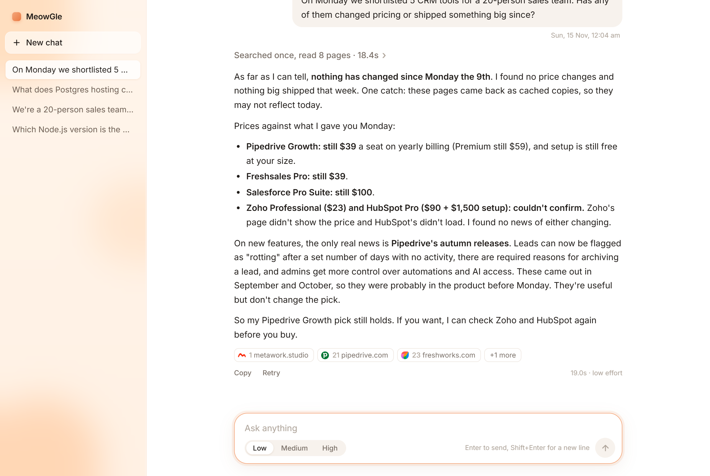
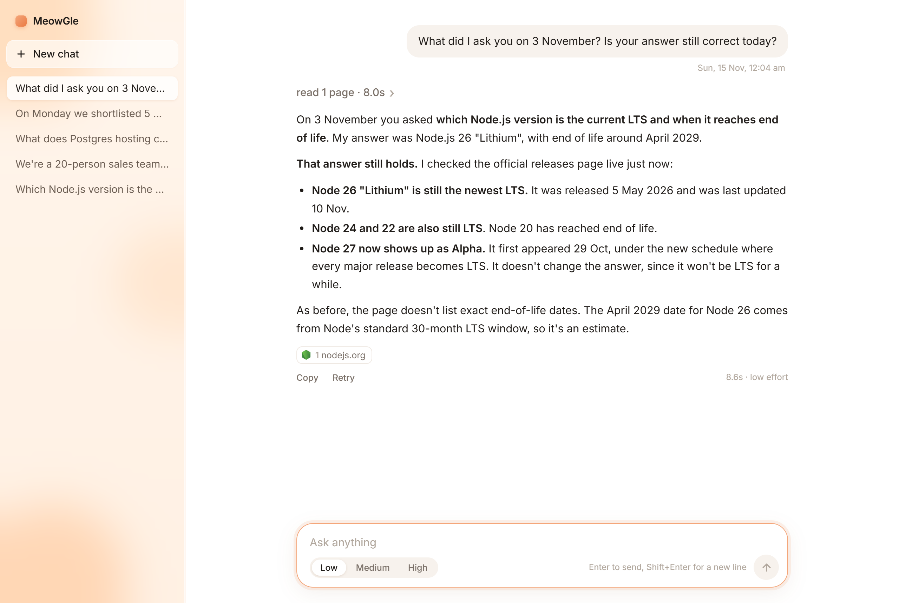
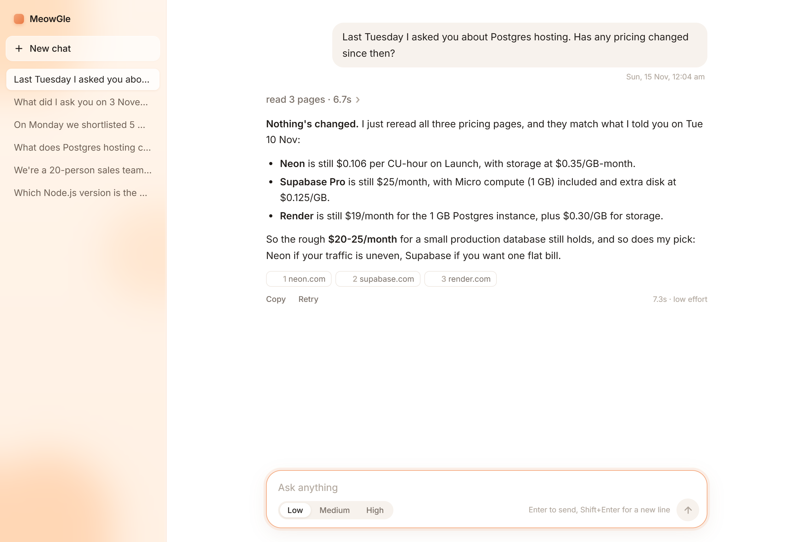
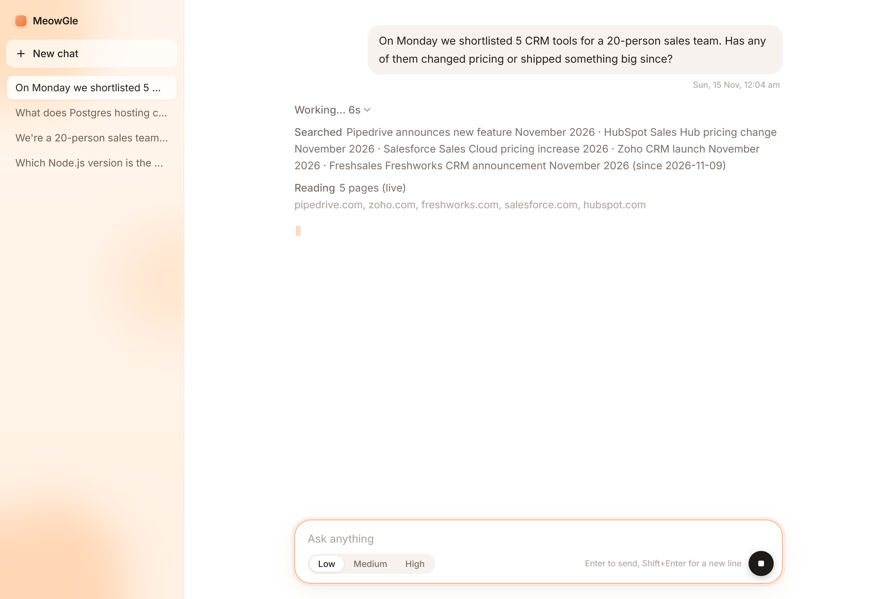
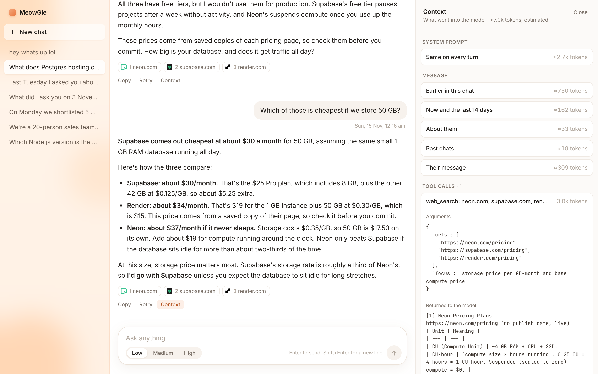

# MeowGle

A chat agent with one tool, web search, that remembers what you asked it, what it told you, and when.

Ask it about Postgres hosting on Tuesday. On Sunday ask "has anything changed since then". It knows which day Tuesday was, what it told you, which page each number came from, and it re-reads those pages live before answering.



How it's built and why: [DESIGN.md](DESIGN.md).

## What you need

- Node 22.13 or newer
- Claude access: a Claude subscription (Pro, Max, Team) or an Anthropic API key
- An Exa API key

One runtime dependency: `@anthropic-ai/claude-code`, pinned. That's the Claude Code CLI, which MeowGle runs as its model, so you don't need it installed globally. Everything else (TypeScript, tsx, prettier, Node types) is dev-only.

## Run it

```bash
npm install
cp .env.example .env
```

Fill in `.env`:

- Claude, one of:
  - `CLAUDE_CODE_OAUTH_TOKEN` for a Claude subscription. Get one with `npx claude setup-token` and paste what it prints.
  - `ANTHROPIC_API_KEY` from console.anthropic.com.

  If both are set, the subscription token is used. Either way MeowGle runs the CLI with its own config dir (`data/claude-config`), so your own Claude Code settings are never read or changed.
- `EXA_API_KEY` from dashboard.exa.ai.

Then:

```bash
npm run dev
```

Open http://localhost:3000. The server only listens on 127.0.0.1, so nothing else on your network can use it.

## Give it a past (optional)

A fresh install has no history, so "what did I ask you last Tuesday" correctly gets "nothing". To try the memory features right away, seed it before the first `npm run dev`:

```bash
npm run seed
```

The seed asks four questions through the real agent, with the clock set back to the day each was "asked":

| When | Chat | Question |
| --- | --- | --- |
| 3 November, 11:00 | Node | Which Node.js version is the current LTS, and when does it reach end of life? |
| Last Monday, 10:30 | CRM | We're a 20-person sales team and need a CRM. Shortlist 5 options with their per-seat monthly price. |
| Last Monday, 10:45 | CRM | Which one would you pick for us, and why? |
| Last Tuesday, 16:00 | Postgres | What does Postgres hosting cost on Neon, Supabase and Render for a small production app? |

Nothing is written by hand. Each question runs the same path as a chat message: real Claude, real Exa searches and page reads, and then the same background filing call that runs after every answer. That call writes the memories: a one-line summary of the reply, labels, up to six checkable values tied to the page they came from, and anything you said about yourself ("20-person sales team" becomes a fact about you). Code checks each one against the answer and the pages actually read. The seed waits for that filing before asking the next question, so the Monday follow-up is answered with the Monday shortlist in view.

Only the timestamps are moved into the past. The pages are read when you run the seed, so the prices are today's, and a "has it changed?" question will usually find them unchanged. It uses about four short turns of your Claude access and a handful of Exa calls, and it refuses to run on a database that already has chats. To seed a separate database, set `DB_PATH` for both commands.

Then try the questions from the brief:

- On Monday we shortlisted 5 CRM tools for a 20-person sales team. Has any of them changed pricing or shipped something big since?
- What did I ask you on 3 November? Is your answer still correct today?
- Last Tuesday I asked you about Postgres hosting. Has any pricing changed since then?





## Using it

Type a question. While it works you see what it's doing: what it searched, how many results came back and from where, which pages it's reading live. That trail folds into one line when the answer starts streaming.



Every answer has a **Context** button. It opens a panel on the right with exactly what went into the model for that turn: the system prompt, the message split into its parts (earlier in this chat, the date strip, what you've told it about yourself, past chats, your message), and every `web_search` call with its arguments and the text that came back, each with its size in estimated tokens. It's saved with the turn, so reopening an old chat shows it too. Turns asked before this was added have none.



The effort toggle (low, medium, high) controls how much it checks, not how much it talks:

| Effort | Tool calls | What it does |
| --- | --- | --- |
| low | 3 | one search round, opens the primary page if the answer is a number that moves |
| medium | 6 | searches every part of the question, reads the pages the answer rests on |
| high | 12 | searches wide, reads pages in full, cross-checks the figures |

Citations show up as small numbers in the reply and a sources row underneath.

## Tests

```bash
npm test
```

```bash
npm run typecheck
```

Tests never touch the network. The model and search are passed in as functions, so the tests swap in fakes and drive a full turn: tool calls, streamed events, persistence, the tool budget, live re-reads of stored URLs.

## Layout

```
src/server.ts    HTTP routes, SSE, the MCP endpoint
src/setup.ts     db, model and tools from .env, shared by the server and the seed
src/agent.ts     runTurn(): one chat turn, start to finish
src/llm.ts       spawns `claude -p`, parses its stream, serves MCP
src/tools.ts     web_search (searches and page reads) against Exa
src/memory.ts    SQLite, the question ledger, the date strip, the extractor, the FTS index
src/recall.ts    which past chats ride along with each message
src/prompt.ts    the system prompt, effort settings, message building
scripts/seed.ts  npm run seed
public/index.html  the whole UI, no build step
```

## Known gaps

- Every turn spawns a fresh `claude -p` process. That startup cost is what I pay for one code path that runs on a subscription or an API key alike.
- Exa sometimes serves a cached copy of a page even when asked for a live one. MeowGle says so in the answer rather than hiding it.
